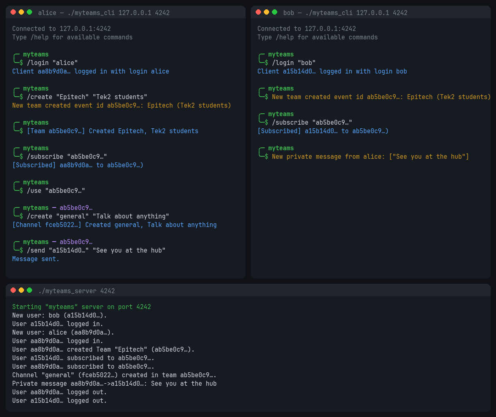

# MyTeams


A simplified **Microsoft Teams** clone running in the terminal: a TCP server written in C and a command-line client written in C++. Users can send private messages, create teams, channels, threads and replies, subscribe to teams and get live notifications. All data is saved to JSON files when the server stops.



<sub>A real session: `alice` creates a team and a channel, then sends a private message to `bob` (UUIDs shortened for readability).</sub>

> [!WARNING]
> This is an **Epitech school project**. If you are an Epitech student working on the same subject, **do not copy this code as is**: you will not learn anything from it, and it will be flagged as cheating. Read it, understand it, then write your own.

## Requirements

- Linux
- `gcc` and `g++` (C++17), `make`
- `libuuid` (`uuid-dev` on Debian/Ubuntu, `libuuid` on Arch, `libuuid-devel` on Fedora)
- Optional: `epiclang` (Epitech's compiler wrapper). The Makefile uses it when it is installed and falls back to `gcc` otherwise.

## Build

```sh
make            # builds myteams_server and myteams_cli
make ENV=dev    # debug build (gcc, -g3)
make re         # full rebuild
```

## Usage

> [!NOTE]
> The binaries link dynamically against the provided `libs/myteams/libmyteams.so` (required by the subject), so the library path must be set when running them.

```sh
export LD_LIBRARY_PATH=libs/myteams

./myteams_server 4242               # server, listening on port 4242
./myteams_cli 127.0.0.1 4242        # client, in another terminal
```

> [!NOTE]
> The server also reads commands from its standard input and stops when it is closed (`Ctrl+D`) or on `Ctrl+C`. Its data is stored in `data/*.json`; `./clear_server_data.sh` wipes it.

### Example session

```text
/login "alice"
/create "Epitech" "Tek2 students"          # create a team
/subscribe "<team_uuid>"
/use "<team_uuid>"                          # enter the team
/create "general" "Talk about anything"     # create a channel in it
/list                                       # list the team's channels
/use "<team_uuid>" "<channel_uuid>"
/create "Hello" "First thread!"             # create a thread
/send "<user_uuid>" "See you at the hub"    # private message
/logout
```

### Commands

| Command | Description |
| ------- | ----------- |
| `/help` | Show all commands |
| `/login "name"` · `/logout` | Log in (account created on first login) / log out |
| `/users` · `/user "uuid"` | List users / show one user |
| `/send "uuid" "message"` · `/messages "uuid"` | Send a private message / show the conversation |
| `/subscribe` · `/unsubscribe` · `/subscribed` | Manage team subscriptions |
| `/use [team [channel [thread]]]` | Set the current context |
| `/create` · `/list` · `/info` | Create, list or describe items in the current context |
| `/quit` · `/exit` | Quit the client |

See [DOC.md](DOC.md) for every command's arguments, the network protocol and the response codes.

## Checking the subject's constraints

```sh
./tester.sh     # libmyteams.so is linked dynamically, no fork / pthread
```

## Contributors

- [VivicatcHub](https://github.com/VivicatcHub)
- [LORAY-guy](https://github.com/LORAY-guy)
- [Charles-n1](https://github.com/Charles-n1)

## License

Free to use for any purpose, including commercial use, as long as you credit **Vivicaty**. See [LICENSE.md](LICENSE.md).
